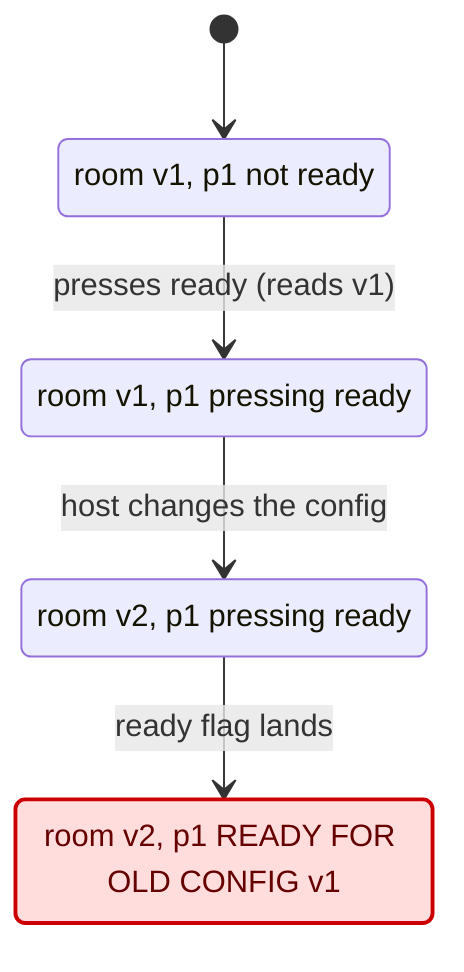

# Example: lobby ready flags

A runnable, from-scratch example of what the skill leaves behind in a project: a model, a gate that can fail, a drift guard with a `keys` entry, a project-local verify skill, and a statechart. The lobby is a toy (about 110 lines, no dependencies, loopback only); the bug class is real: a flag written after an await lands on state that moved during the await.

## The rule and the bug

The owner's words: *nobody is "ready" for a config they never saw.* The host can change the room's config; a change clears every ready flag. `handleReady` reads the config version, awaits the store, then writes the flag. Between the read and the write the host can change the config, and without the re-check the flag lands with the old version: the game can start on a config a player never agreed to.



The full chart is `formal/statechart.mmd`; `formal/statechart.sh` redraws it.

## Files

| File | Role in the skill |
|---|---|
| `server.mjs` | the code under verification; `createLobby({ fix })` is the switch the model mirrors (`CONSTANT Fix`) |
| `lobby.config.json` | a config value the model treats as a constant (`maxPlayers` = size of `Players`) |
| `lobby.test.mjs` | Phase 1 step 11: the counterexample replayed on the real code, await held open with a gate store; one test for the fixed code, one for the mutant, two for the guards a reviewer found missing (after Start, in-flight ready) |
| `formal/Lobby.tla`, `formal/MC.tla` | the model: atomic steps = code between awaits; `Done` so a finished game is not a deadlock |
| `formal/MC_guard.cfg` | Phase 2 step 14: today's code, must pass |
| `formal/MC_mutant.cfg` | step 15: the mutation run, must break `ReadyMatchesConfig` |
| `formal/coverage.json` | step 18: four `symbol` entries and one `keys` entry for `scripts/drift-guard.mjs` |
| `formal/gate.sh` | step 17: one command, four rows; each row needs the expected count (5/5 entries, 4/4 tests, a state count) and the matching exit code; 0 of anything, a skipped test, or a TLC exit other than 0/12 is FAIL |
| `formal/VERIFY.md` | step 17: the project-local verify skill (frontmatter, covered table, how to tell bug from modeling error, re-sync steps, bounds) |
| `formal/view.mjs`, `formal/statechart.sh`, `formal/statechart.mmd` | Statechart: labels in the owner's words; works with pstack `statechart` and with the fallback renderer |

## Run it

```sh
examples/lobby-ready/formal/gate.sh          # drift + repros + TLC, about 4 s
node --test examples/lobby-ready/lobby.test.mjs
node examples/lobby-ready/server.mjs          # http://127.0.0.1:4747 ; --no-fix runs the mutant
```

Try the bug by hand against the running `--no-fix` server: two terminals, `POST /ready {"id":"p1"}` and `POST /config {"mode":"speed"}` within the same tick is hard to hit from curl; the test holds the await open instead. That is the point: tests cannot reach this interleaving unless they control the await.

## Proof the gate can fail (step 19)

By hand on 2026-11-03, each scratch change applied, `gate.sh` run, change reverted, gate back to PASS:

| Scratch change | drift row | repros row | TLC rows |
|---|---|---|---|
| delete the re-check in `handleReady` | FAIL (1 body) | FAIL (fixed-code test) | `MC_guard` unchanged (the model still has Fix on; the drift row is what points here) |
| `maxPlayers` 2 → 3 in `lobby.config.json` | FAIL (keys entry) | OK | unchanged |
| weaken `ReadyMatchesConfig` to `TRUE` | OK | OK | `MC_mutant` breaks `StartOnAgreedConfig` instead of the expected rule → FAIL |
| empty the `covered` array | FAIL (0/5 ok) | OK | unchanged |
| mark the fixed-code test `skip` | OK | FAIL (3/4 ran) | unchanged |

In the repo suite (`scripts/test/example-lobby-ready.test.mjs`, no Java needed) only the first two rows' drift results and the first row's repro result are automated; the TLC rows are not, so a weakened property is caught by `gate.sh` and by nothing else.

## What a reviewer caught (2026-11-03)

The first version of the model had `started = 0` guards on `ReadyBegin`, `HostChange` and `Start` that the code did not have, and no in-flight check. A second-opinion review (Codex) showed the real trace: start on v1, host changes to v2, a player presses ready, and `StartOnAgreedConfig` breaks with the fix on. The code was made to match the model (requests after Start are rejected, a second ready while one is in flight is rejected, `handleJoin` is covered), and `lobby.test.mjs` holds that trace as a test. The lesson is step 5 of the skill: every guard in a model action must be a line of code you can point at.

## Limits of the example

- The fallback renderer leaves a TLA+ function as its raw text; `view.mjs` parses `(p1 :> 1 @@ p2 :> 1)` itself. pstack's `statechart` hands the view a parsed object.
- TLC stops at the first violation, so `statechart.mmd` shows the states explored up to the bug (11), not the full 44.
- The `keys` entry points at a config file here. In a real project the same form points at the lockfile: `{ "file": "package-lock.json", "keys": ["packages.node_modules/ws.version"] }`.
